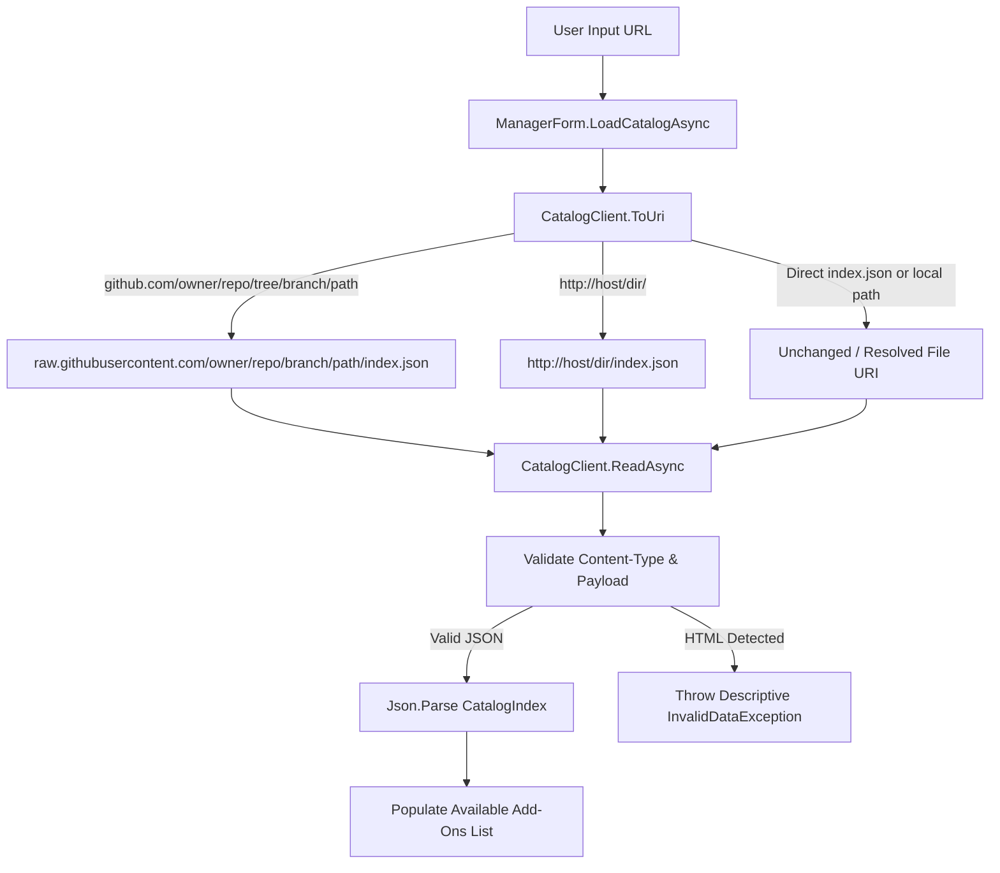

# Requirements

### Overview & Goals
When loading an add-on catalog from a GitHub web URL such as `https://github.com/bolsover/bolsover.github.io/tree/main/AlibreAddOns`, the Add-On Manager's `LoadCatalogAsync` fails with `System.Runtime.Serialization.SerializationException: Encountered unexpected character '<'`. 

The goal of this change is to:
1. Automatically recognize and normalize GitHub web repository URLs (including `/tree/`, `/blob/`, and repository roots) and general web directory URLs into valid, direct raw `index.json` endpoints.
2. Provide clear, descriptive error messages when a remote host returns an HTML page or invalid content instead of the raw JSON exception `Encountered unexpected character '<'`.

### Scope
#### In Scope
- URL normalization in `CatalogClient.ToUri` to handle:
  - GitHub tree URLs: `https://github.com/{owner}/{repo}/tree/{branch}/{path}` -> `https://raw.githubusercontent.com/{owner}/{repo}/{branch}/{path}/index.json`.
  - GitHub blob URLs: `https://github.com/{owner}/{repo}/blob/{branch}/{path}` -> `https://raw.githubusercontent.com/{owner}/{repo}/{branch}/{path}`.
  - GitHub repo root URLs: `https://github.com/{owner}/{repo}` -> `https://raw.githubusercontent.com/{owner}/{repo}/main/index.json`.
  - Web directory URLs: URLs ending with `/` or without a `.json` file extension append `index.json`.
- Response content validation and diagnostic error handling in `CatalogClient` to detect HTML responses and report user-friendly error messages.

#### Out of Scope
- Modifying catalog schema format or manifest structure.
- Altering the registry-based add-on installation logic.

### User Stories
- **As an add-on user**, I want to paste a GitHub repository or folder link into the Catalog URL field so that the Add-On Manager automatically resolves and loads the catalog without manual URL conversion.
- **As an add-on user**, I want to receive clear feedback if a URL returns an HTML page or invalid endpoint so that I understand why the catalog failed to load.

### Functional Requirements
- Entering `https://github.com/bolsover/bolsover.github.io/tree/main/AlibreAddOns` must successfully load the catalog index from `https://raw.githubusercontent.com/bolsover/bolsover.github.io/main/AlibreAddOns/index.json`.
- Subsequent manifest fetching (`addons/{GUID}.json`) and package downloading (`packages/...`) must resolve correctly against the raw GitHub base URL.
- Direct file URLs like `http://www.bolsover.com/catalog/index.json` and local paths (e.g. `C:\catalog` or `C:\catalog\index.json`) must continue to work without regression.
- If a server responds with `Content-Type: text/html` or HTML content starting with `<`, `CatalogClient` must throw a clear `InvalidDataException` stating that an HTML page was returned instead of a JSON catalog.

# Technical Design

### Current Implementation & Root Cause Analysis
In `src/AlibreAddOnManager/CatalogClient.cs`:
1. `ToUri(string location)` checks if `location` is an absolute URI. For non-file URIs (`http://` / `https://`), it returns the URI without modification:
   ```csharp
   if (Uri.TryCreate(location, UriKind.Absolute, out var uri) && !uri.IsFile)
       return Check(uri);
   ```
2. When the user inputs `https://github.com/bolsover/bolsover.github.io/tree/main/AlibreAddOns`, `ReadAsync(IndexUri)` issues an HTTP GET to GitHub's web interface.
3. GitHub returns HTTP 200 with an HTML document starting with `<!DOCTYPE html>`.
4. `Json.Parse<CatalogIndex>` uses `DataContractJsonSerializer`, which encounters `<` as the first token and throws `SerializationException: Encountered unexpected character '<'`.

### Key Decisions
- **Convert GitHub Web URLs to `raw.githubusercontent.com`**: GitHub web interface URLs (`github.com/.../tree/...` and `github.com/.../blob/...`) serve HTML views. Transforming them to `raw.githubusercontent.com` allows direct access to the raw files for public repositories on GitHub.
- **Normalize Directory URLs to `index.json`**: For any HTTP/HTTPS URL whose path is a directory (ends in `/` or has no file extension), normalize by appending `index.json`. This mirrors the existing behavior for local directories (`Directory.Exists(path) -> Path.Combine(path, "index.json")`) and ensures relative URI resolution with `new Uri(IndexUri, relativePath)` resolves correctly against the directory base.
- **Fail Fast on HTML Content-Type**: Inspect `response.Content.Headers.ContentType` and the first character of the response stream to distinguish HTML pages from valid JSON before parsing, providing clear error feedback.

### Proposed Changes
#### `src/AlibreAddOnManager/CatalogClient.cs`
- **Enhance `ToUri(string location)`**:
  - Detect `github.com` host:
    - Parse path segments: `/{owner}/{repo}/tree/{branch}/{subpath...}` or `/{owner}/{repo}/blob/{branch}/{subpath...}`.
    - Convert to `https://raw.githubusercontent.com/{owner}/{repo}/{branch}/{subpath...}`.
    - If `{subpath}` does not end with `.json`, append `/index.json`.
  - For general HTTP/HTTPS URLs:
    - If `uri.AbsolutePath.EndsWith("/")`, append `index.json`.
    - If `!Path.HasExtension(uri.AbsolutePath)` and `!uri.AbsolutePath.EndsWith(".json", StringComparison.OrdinalIgnoreCase)`, append `/index.json`.
- **Enhance `ReadAsync(Uri uri)` & `LoadIndexAsync`**:
  - Check `response.Content.Headers.ContentType?.MediaType`. If `text/html`, throw `InvalidDataException($"The URL '{uri}' returned an HTML page instead of JSON catalog data. Ensure the URL points to a raw catalog or valid index.json.")`.
  - Check for leading `<` character before deserializing JSON and wrap any `SerializationException` with user-friendly error context.

### Architecture Diagram


### Risks & Mitigations
- **Risk**: GitHub URL format variants (e.g. tree with multiple nested path segments or trailing slashes).
  - *Mitigation*: Parse segments dynamically using `Uri.Segments` and combine remaining segments into the repository subpath.
- **Risk**: Custom web servers that do not serve `index.json` as the catalog file name.
  - *Mitigation*: If the user explicitly specifies a different `.json` filename in the URL, `ToUri` preserves the specified file name intact.

# Testing

### Validation Approach
Verify catalog loading across all supported URL forms and ensure informative error handling for invalid or HTML endpoints.

### Key Scenarios
1. **GitHub Tree URL**:
   - Input: `https://github.com/bolsover/bolsover.github.io/tree/main/AlibreAddOns`
   - Expected: Successfully loads catalog index and manifests from `raw.githubusercontent.com`.
2. **GitHub Blob URL**:
   - Input: `https://github.com/bolsover/bolsover.github.io/blob/main/AlibreAddOns/index.json`
   - Expected: Successfully loads catalog index.
3. **HTTP Web URL**:
   - Input: `http://www.bolsover.com/catalog/index.json`
   - Expected: Loads index without regression.
4. **Local Directory & File Paths**:
   - Input: Local directory path and direct `index.json` path.
   - Expected: Loads index correctly as before.
5. **HTML Response Error Handling**:
   - Input: A standard web page URL returning HTML (e.g., `https://github.com` or `https://google.com`).
   - Expected: Throws a clear `InvalidDataException` stating HTML was received, rather than `Encountered unexpected character '<'`.

### Edge Cases
- URL with trailing slash: `https://github.com/bolsover/bolsover.github.io/tree/main/AlibreAddOns/`.
- Relative manifest resolution: Verify `addons/{GUID}.json` is resolved properly relative to the raw GitHub directory.
- Relative package URL resolution: Verify `packages/{Name}.alibreaddon` resolves and downloads properly from raw GitHub.

# Delivery Steps

### ✓ Step 1: Implement GitHub and Web Catalog URL Normalization in CatalogClient
`CatalogClient.ToUri` automatically normalizes GitHub repository web URLs, GitHub Pages URLs, and directory paths to point directly to raw `index.json` endpoints.

- Update `CatalogClient.ToUri` in `src/AlibreAddOnManager/CatalogClient.cs` to detect `github.com` URLs containing `/tree/`, `/blob/`, or repo roots, converting them into equivalent `raw.githubusercontent.com` URLs pointing to `index.json`.
- Add automatic normalization for HTTP/HTTPS directory URLs (e.g., URLs without a `.json` extension or ending in `/`) so they append `index.json` or `/index.json`.
- Preserve existing local file and folder resolution behavior (`Directory.Exists` path appending `index.json`).

### ✓ Step 2: Add Content-Type and HTML Response Validation with Descriptive Error Handling
`CatalogClient` rejects HTML/XML responses and provides clear, actionable error messages instead of raw JSON deserialization syntax errors.

- Update `CatalogClient.ReadAsync` in `src/AlibreAddOnManager/CatalogClient.cs` to check the HTTP `Content-Type` header and inspect the first non-whitespace character of downloaded content.
- Throw a descriptive `InvalidDataException` when an HTML response (such as a 404 page, web portal, or unhandled web UI page) is received instead of JSON.
- Enhance `LoadIndexAsync` and `LoadManifestAsync` to catch JSON parsing/deserialization exceptions and format user-friendly error messages that indicate the catalog source returned HTML or non-JSON content.